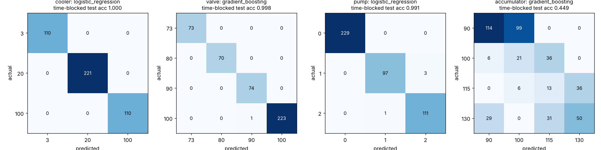
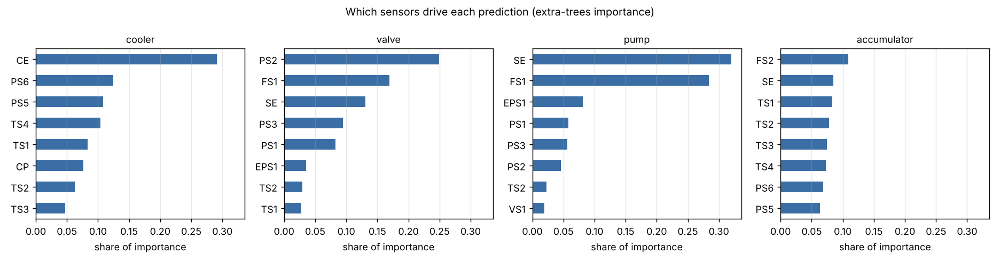
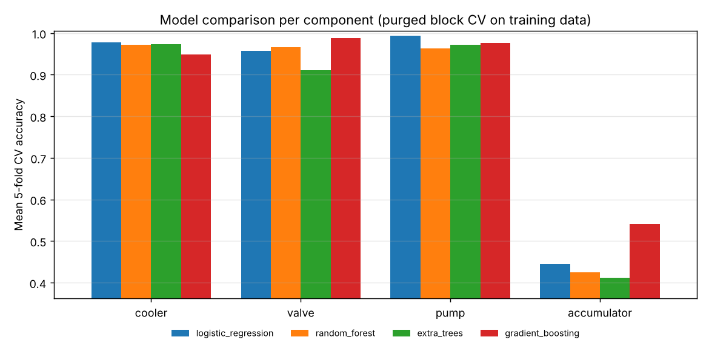

# Hydraulic System Condition Analysis

Classifies the condition of four components of a hydraulic test rig (**cooler**, **valve**, **pump** and **accumulator**) from one 60-second load cycle of 17 sensor signals, and serves the predictions through a REST API.

**Documentation:** [Architecture](docs/ARCHITECTURE.md) (diagrams, modules, data flow, design decisions) · [Project guide](docs/PROJECT_GUIDE.md) (how it was built, concepts, tools, interview questions)

## Results on the real dataset

All 2,205 cycles of the UCI dataset, 204 features per cycle.

**Evaluation is time-blocked.** Consecutive cycles on the rig are near-copies, so the held-out test set is every 5th block of consecutive cycles (20 %, spread over the whole run so every condition level appears), and 15 cycles on each side of a test block are removed from training. The model for each component is chosen by purged block cross-validation on the training cycles and then scored once on the time-blocked test set. For comparison, the same model is also scored on a random stratified 80/20 split.

| Component | Classes | Selected model | CV accuracy (purged blocks) | **Time-blocked test accuracy** | Test macro F1 | Random-split accuracy |
|---|---|---|---|---|---|---|
| Cooler | 3 | Logistic regression | 97.8 % ± 3.7 | **100.0 %** | 1.000 | 100.0 % |
| Valve | 4 | Gradient boosting | 98.8 % ± 1.5 | **99.8 %** | 0.998 | 99.1 % |
| Pump | 3 | Logistic regression | 99.5 % ± 0.7 | **99.1 %** | 0.987 | 100.0 % |
| Accumulator | 4 | Gradient boosting | 54.1 % ± 21.4 | **44.9 %** | 0.389 | 99.3 % |



### What the time-blocked evaluation shows

**Cooler, valve and pump generalise to unseen periods of operation (99–100 %).** Their faults leave a stable physical fingerprint: cooling efficiency for the cooler, the timing of pressure build-up and flow for the valve, and efficiency, flow and motor power for the pump.

**The accumulator does not.** On a random split it scores 99.3 %, but on unseen time blocks only 44.9 %, a gap of about 54 points. Its states run in 12 long periods of about 180 cycles, and the model learns what those periods look like (slow drift of the rig) rather than the accumulator's own effect. Accuracy falls further the larger the gap between training and test cycles. This holds for every candidate model and also when only pressure and flow sensors are used. A random split hides this completely.

### Window features: the 25-point valve gap

Under time-blocked validation, the original 68 whole-cycle statistics (mean, std, min, max) were not good enough for the valve:

| Features | Valve, time-blocked CV | Valve, random test split | Pump, time-blocked CV |
|---|---|---|---|
| 68 whole-cycle statistics | 72.9 % ± 12.9 | 98.0 % | 95.3 % ± 4.4 |
| **204 with window, slope and roughness features** | **98.4 % ± 1.6** | **99.1 %** | **97.9 % ± 2.5** |

The random split hid a 25-point gap. Valve lag changes **when** pressure builds up during the cycle, not its average level, so plain statistics lose that information. Splitting each cycle into six time windows and adding the linear slope recovers it. (These numbers come from the earlier plain time-blocked folds without purge gap.)

### Which sensors matter



The importances match the physics of the three components that generalise:
- **Cooler** depends on cooling efficiency (CE) and temperatures.
- **Valve** depends on system pressure (PS2) and flow (FS1).
- **Pump leakage** depends on the efficiency factor (SE), flow (FS1) and motor power (EPS1).
- **Accumulator** importance is spread across many sensors with no clear physical signal, which fits the time-blocked result: the model has not found a stable accumulator fingerprint.



Full numbers are in [`reports/results.json`](reports/results.json).

## Pipeline

| Stage | What it does | Code |
|---|---|---|
| Data | Loads 17 sensor files and the labels; checks alignment across cycles and rejects NaN/inf | `src/hydraulic/data.py` |
| Features | Vectorised NumPy, 12 per sensor = 204: mean, std, min, max, 6 time-window means, slope, mean absolute change | `src/hydraulic/features.py` |
| Models | Logistic regression, random forest, extra trees and gradient boosting; selected by purged block CV; scored once on a time-blocked hold-out with a purge gap; compared with a random split; refit on all data | `src/hydraulic/model.py` |
| Reports | Model comparison, confusion matrices, sensor importance, `results.json` | `src/hydraulic/train.py` |
| Serving | FastAPI with Pydantic request models; 422 on invalid input, 503 if no model; prediction logic decoupled from the API | `src/hydraulic/api.py` |
| Tests | 31 pytest tests: data validation, feature maths, time-blocked hold-out and purged CV, model selection, API error paths | `tests/` |

## Dataset

UCI Machine Learning Repository: *Condition monitoring of hydraulic systems* (Helwig, Pignanelli, Schütze, 2015). It is also on Kaggle as *Condition Monitoring of Hydraulic Systems*.

| Sensor | Quantity | Rate | Samples/cycle |
|---|---|---|---|
| PS1–PS6 | Pressure [bar] | 100 Hz | 6000 |
| EPS1 | Motor power [W] | 100 Hz | 6000 |
| FS1–FS2 | Volume flow [l/min] | 10 Hz | 600 |
| TS1–TS4 | Temperature [°C] | 1 Hz | 60 |
| VS1 | Vibration [mm/s] | 1 Hz | 60 |
| CE, CP, SE | Cooling efficiency, cooling power, efficiency factor | 1 Hz | 60 |

Targets (from `profile.txt`):

- **cooler**: 3 = close to total failure, 20 = reduced efficiency, 100 = full efficiency
- **valve**: 100 = optimal, 90 = small lag, 80 = severe lag, 73 = close to total failure
- **pump**: 0 = no leakage, 1 = weak leakage, 2 = severe leakage
- **accumulator**: 130 = optimal, 115 = slightly reduced, 100 = severely reduced, 90 = close to total failure (pressure in bar)

Put the 17 sensor `.txt` files and `profile.txt` in `data/raw/` (about 530 MB, not committed).

A **synthetic generator** (`make_synthetic`) produces data in the same layout with simple fault physics. It is used by the tests and to run the pipeline without the download. It is deliberately easy to separate, so accuracy on it says nothing about the real data.

## Quick start

```bash
python -m venv .venv && source .venv/bin/activate
pip install -e ".[dev]"

# train (about 2.5 minutes on the real data)
hydraulic-train --data data/raw
hydraulic-train --synthetic            # no download needed

# test
pytest

# serve
uvicorn hydraulic.api:app --reload
# docs at http://127.0.0.1:8000/docs
```

## API

| Method | Path | Body |
|---|---|---|
| GET | `/health` | – |
| POST | `/predict/cycle` | `{"signals": {"PS1": [...], ..., "SE": [...]}}` with the raw samples of one cycle, all 17 sensors |
| POST | `/predict/features` | `{"features": {"PS1_mean": 160.1, ...}}` with the 204 precomputed features |

Example response:

```json
{
  "cooler":      {"label": 100, "description": "full efficiency",  "confidence": 0.998},
  "valve":       {"label": 80,  "description": "severe lag",       "confidence": 0.977},
  "pump":        {"label": 2,   "description": "severe leakage",   "confidence": 0.993},
  "accumulator": {"label": 130, "description": "optimal pressure", "confidence": 0.960}
}
```

Error handling: a missing or unknown sensor, fewer than 6 samples, non-numeric or non-finite values, or missing features return **422** with the offending name in the message. If no trained model is on disk, the API returns **503**.

## Docker

```bash
hydraulic-train --data data/raw        # or --synthetic
docker build -t hydraulic-api .
docker run -p 8000:8000 hydraulic-api
```

## Project layout

```
docs/           architecture and project guide
src/hydraulic/
  config.py     sensor rates, label meanings, CV scheme per target
  data.py       loading, validation, synthetic generator
  features.py   per-cycle features
  model.py      model selection, evaluation, ConditionPredictor
  train.py      CLI, plots, results.json
  api.py        FastAPI service
tests/          pytest suite
models/         saved model bundle (generated)
reports/        plots and results from the real-data run
```

## Possible extensions

- Accumulator features that are robust to slow drift of the rig: frequency-domain features (FFT band energy on PS and EPS1) for pressure pulsation, and per-period normalisation
- Hyperparameter search inside the cross-validation
- Use the `stable` flag to study cycles where the rig had not reached steady state

## License

[MIT](LICENSE) © 2026 Jatin Mathur
