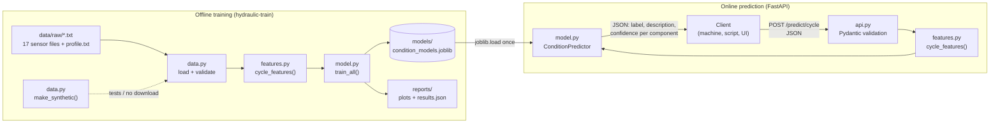
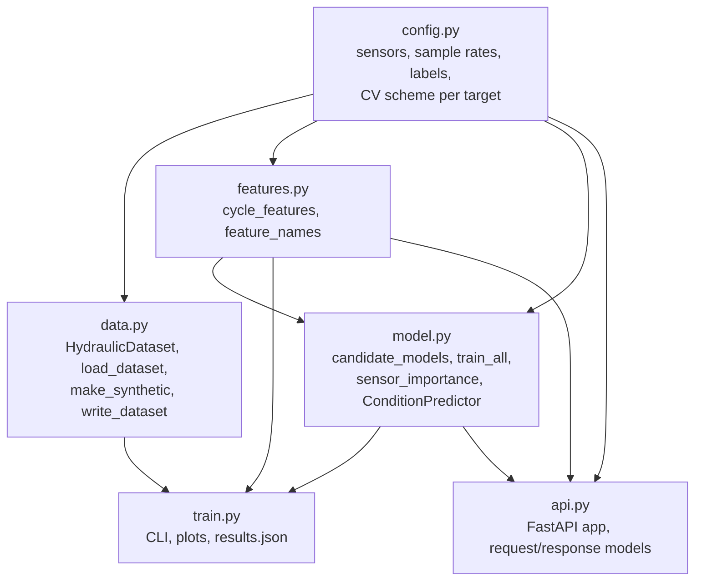
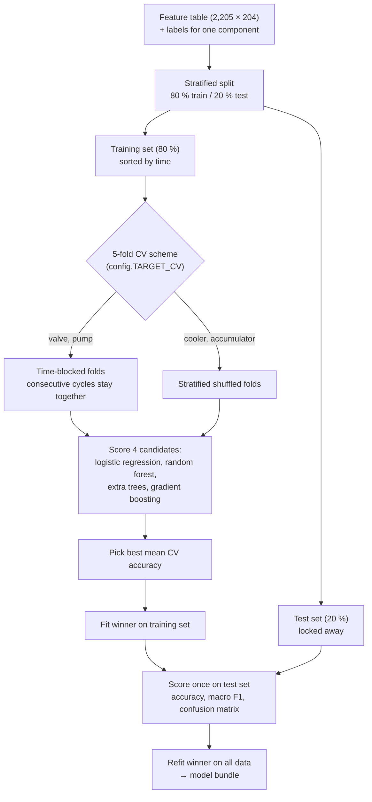
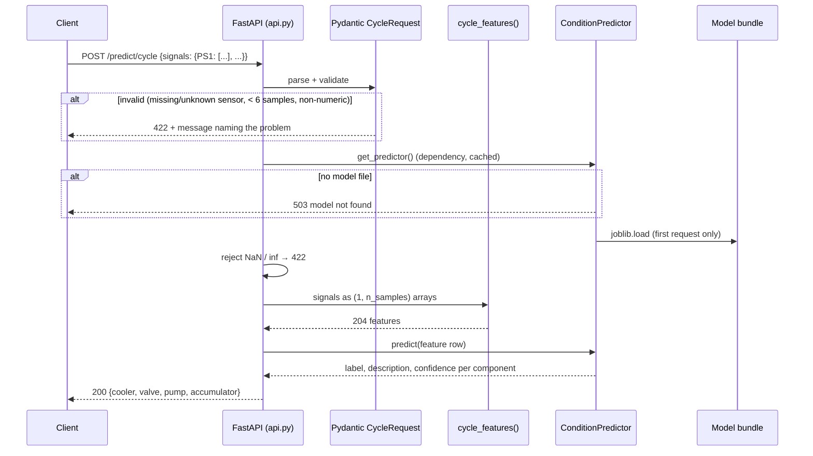
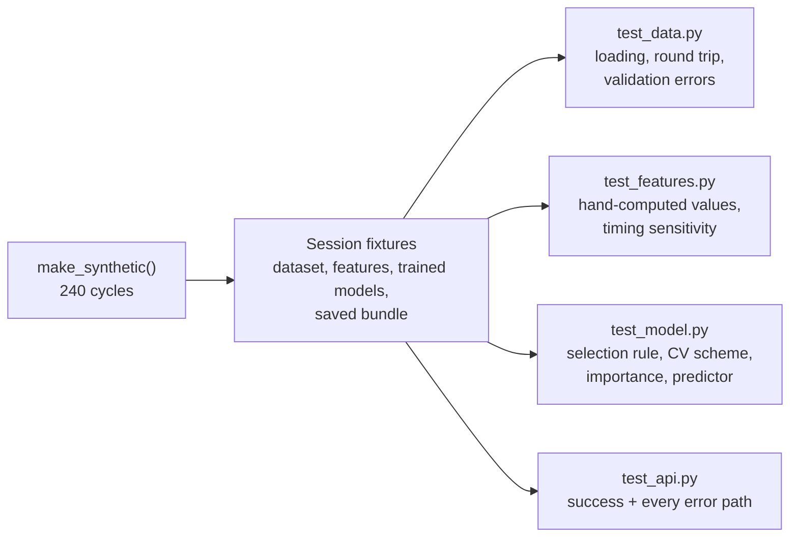
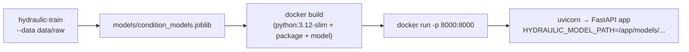

# Architecture

This document describes how the system is built: the components, how data flows through them, how a model is trained and evaluated, and why it is designed this way.

## 1. System overview

The system has two paths that share the same feature code:

- **Offline training** turns raw sensor files into a saved model bundle and reports.
- **Online prediction** turns one cycle of sensor data, sent over HTTP, into a condition for each component.

Training and serving call the **same** `cycle_features()` function. This prevents training/serving skew: the model always receives features computed exactly as during training.

## 2. Modules and dependencies

Each module has one responsibility, and dependencies point one way: `config` is at the bottom, and the two entry points (`train`, `api`) are at the top. No module imports an entry point.

| Module | Responsibility | Depends on |
|---|---|---|
| `config.py` | Single source of truth: sensor names and sample counts, label meanings, CV scheme per target, feature settings | – |
| `data.py` | Read the UCI files, validate them, generate synthetic data in the same format | config |
| `features.py` | Turn raw signals `(cycles, samples)` into a feature table `(cycles, 204)` | config |
| `model.py` | Candidate models, model selection, evaluation, sensor importance, saving, prediction | config, features |
| `train.py` | Command-line entry point; runs the pipeline and writes plots and `results.json` | data, features, model |
| `api.py` | HTTP entry point; validates requests and delegates to `ConditionPredictor` | config, features, model |

## 3. Data model

| Object | Shape / type | Meaning |
|---|---|---|
| Raw sensor file, e.g. `PS1.txt` | 2,205 rows × 6,000 columns | One row per cycle, one column per sample |
| `HydraulicDataset.signals` | `dict[str, ndarray]`, 17 entries | Sensor name → `(n_cycles, n_samples)` float32 array |
| `HydraulicDataset.profile` | DataFrame, 2,205 × 5 | Labels: cooler, valve, pump, accumulator, stable |
| Feature table | DataFrame, 2,205 × 204 | 17 sensors × 12 features |
| Model bundle | joblib file | `{"features": [204 names], "models": {target: fitted model}}` |

Sensors are sampled at different rates (100 Hz, 10 Hz and 1 Hz), so their arrays have different widths. Feature extraction reduces every sensor to the same 12 numbers per cycle, which aligns them into one table.

### Features per sensor (12)

| Group | Features | What it captures |
|---|---|---|
| Whole-cycle statistics | mean, std, min, max | Level, spread and extremes |
| Time windows | mean of each of 6 equal windows (10 s each) | Shape over time, e.g. how fast pressure builds up |
| Trend | least-squares slope over the cycle | Rising or falling signal |
| Roughness | mean absolute sample-to-sample change | Ripple and noise |

All features are computed with NumPy along `axis=1`, so there is no Python loop over cycles.

## 4. Training and evaluation

This runs once per component (cooler, valve, pump, accumulator).

**Why the test set is used only once:** if the model were chosen by its test score, the reported number would be biased upward, because the test set would have influenced the choice.

**Why time-blocked folds for valve and pump:** consecutive cycles are nearly identical, and a valve state lasts about 15 cycles on average. With shuffled folds, near-duplicates of each test cycle sit in the training data, so weak features look strong. Time-blocked folds test on periods of operation the model has not seen.

**Why stratified folds for cooler and accumulator:** the cooler has only 3 contiguous states over the whole recording and the accumulator 12. A held-out time block would contain a class the model never saw, which tests nothing useful.

### Candidate models

| Model | Preprocessing | Strength |
|---|---|---|
| Logistic regression | StandardScaler | Linear baseline, fast, interpretable |
| Random forest | none | Robust ensemble of decision trees |
| Extra trees | none | Like random forest with random split points; less variance |
| Histogram gradient boosting | none | Builds trees that correct earlier errors; strong on tabular data |

Scaling is placed inside a scikit-learn `Pipeline`, so it is fitted only on training folds and applied identically at prediction time.

## 5. Prediction request flow

### Endpoints

| Method | Path | Input | Output |
|---|---|---|---|
| GET | `/health` | – | status, whether a model file exists |
| POST | `/predict/cycle` | raw samples of one cycle for all 17 sensors | condition of 4 components |
| POST | `/predict/features` | the 204 precomputed features | condition of 4 components |
| GET | `/docs` | – | interactive Swagger UI (generated by FastAPI) |

### Error handling

| Situation | Where it is caught | Status |
|---|---|---|
| Missing, unknown or too-short sensor | Pydantic validator in `CycleRequest` | 422 |
| Non-numeric sample | Pydantic type check | 422 |
| NaN or infinite value | `predict_cycle` endpoint | 422 |
| Missing feature | `ConditionPredictor.predict` raises `KeyError` → mapped | 422 |
| No trained model on disk | `get_predictor` dependency | 503 |

## 6. Design decisions

| Decision | Reason |
|---|---|
| Prediction logic in `ConditionPredictor`, not in the endpoints | The API only translates HTTP to Python. The ML code can be reused from a CLI or batch job and tested without a web server. |
| Predictor provided through FastAPI `Depends` | Tests replace it with `app.dependency_overrides`, so API tests never touch the real model file. |
| Predictor cached with `lru_cache` | The model is loaded from disk once, not on every request. |
| One `config.py` | Sensor list, labels and CV schemes are defined once; adding a component means changing one dictionary. |
| Same feature function for training and serving | Removes training/serving skew. |
| Synthetic data generator with the real file layout | Tests run in seconds without the 530 MB dataset, and they exercise the same loader code as the real data (`write_dataset` → `load_dataset` round trip). |
| pandas C parser instead of `np.loadtxt` | About 20 times faster on the 90 MB pressure files (the full load takes about 16 s). |
| Fixed random seeds | Repeated runs give identical results. |
| Reports committed, raw data and model not | Results are visible on GitHub; large and regenerable files stay out of Git. |

## 7. Testing strategy

| File | Tests | Examples |
|---|---|---|
| `test_data.py` | 7 | file-format round trip, rejects NaN, misaligned cycles, missing sensor |
| `test_features.py` | 7 | values checked by hand for a ramp signal; two signals with equal statistics but different timing get different window features |
| `test_model.py` | 8 | winner equals best CV score, blocked folds are contiguous, importances sum to 1 |
| `test_api.py` | 9 | 200 for valid input; 422 for each kind of bad input; 503 without a model |

Expensive setup (generating data, training models) runs once per test session through `scope="session"` fixtures, so all 31 tests finish in about 35 seconds.

## 8. Deployment

The model path is read from the `HYDRAULIC_MODEL_PATH` environment variable, so the same image can serve a different model without code changes.
